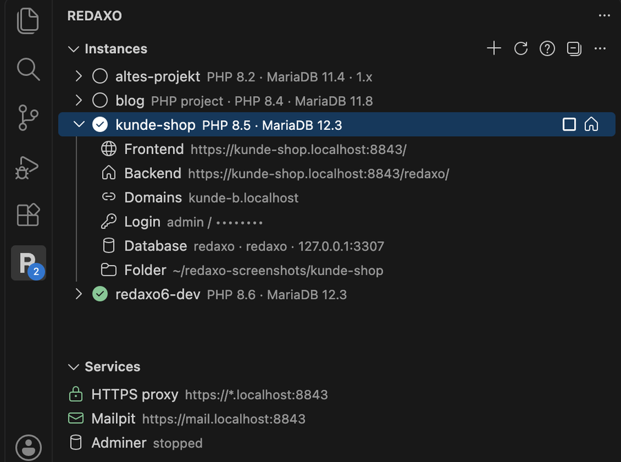
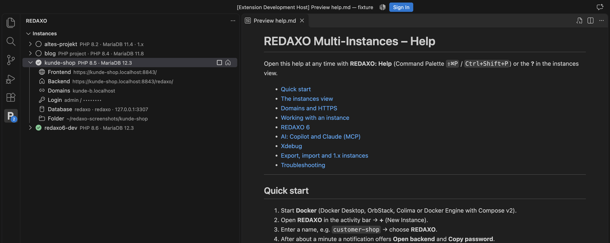
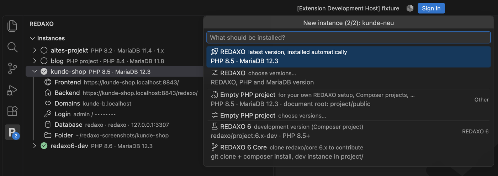
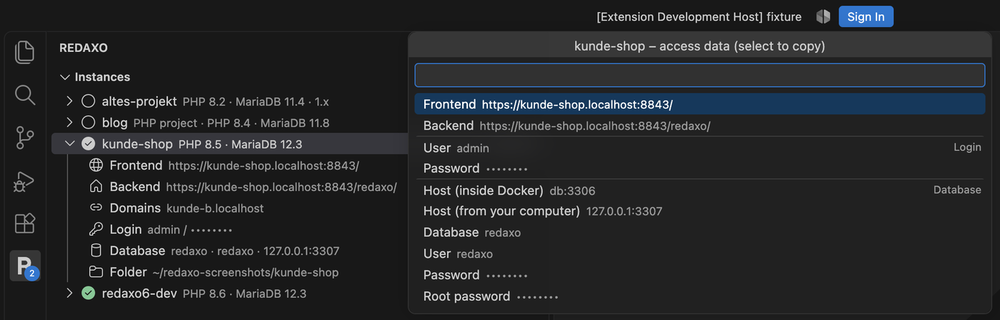

# REDAXO Multi-Instances Manager

Lokale REDAXO- und PHP-Entwicklungsumgebungen mit Docker – direkt in VS Code.
Name eingeben, „REDAXO“ wählen, nach etwa einer Minute läuft REDAXO unter **https://&lt;name&gt;.localhost**.



- **REDAXO 5** (aktuelle Version, automatisch installiert), **REDAXO 6** (Entwicklungsversion) oder ein **leeres PHP-Projekt**
- **PHP 8.1 – 8.6**, **MariaDB 10.11 – 13.0**, Apache 2.4 – Version jederzeit wechselbar
- **HTTPS auf `*.localhost`** ohne Hosts-Datei, mit **Multidomain** (z. B. für YRewrite)
- **Mailpit** fängt alle E-Mails ab, **Adminer** für die Datenbank
- **ImageMagick, libvips, Poppler, Ghostscript, ffmpeg, Composer, Xdebug** sind an Bord
- **KI-Integration:** `@redaxo` im Copilot-Chat, Tools für den Agent-Modus, **MCP-Server für Claude Code / Claude Desktop**

Die ausführliche **Hilfe** ist in der Extension enthalten: Befehl **„REDAXO: Hilfe“** oder das **?** in der
Instanz-Liste (Deutsch und Englisch). Für den Einstieg gibt es zusätzlich **„REDAXO: Erste Schritte“**.



## Voraussetzungen

- [Docker Desktop](https://www.docker.com/products/docker-desktop/) (oder OrbStack, Colima, Docker Engine mit Compose v2)
- Empfohlen: [mkcert](https://github.com/FiloSottile/mkcert) für vertrauenswürdige Zertifikate (`brew install mkcert nss`)

macOS, Linux und Windows (Docker Desktop) werden unterstützt.

## Installation

Die Extension wird über die [GitHub-Releases](https://github.com/FriendsOfREDAXO/redaxo-multi-instances-vscode/releases)
verteilt (nicht über den VS Code Marketplace):

1. Beim neuesten Release die Datei `redaxo-multi-instances-manager-<version>.vsix` herunterladen.
2. In VS Code: Erweiterungen-Ansicht → **…** (oben rechts) → **Aus VSIX installieren…** → Datei wählen.
   Alternativ im Terminal: `code --install-extension redaxo-multi-instances-manager-<version>.vsix`
3. **Developer: Reload Window** ausführen.

Updates installierst du genauso – VS Code aktualisiert per VSIX installierte Erweiterungen nicht automatisch.
Einstellungen und Instanzen bleiben dabei erhalten.

## Schnellstart

1. Links in der Aktivitätsleiste **REDAXO** öffnen.
2. **+** (Neue Instanz) → Namen eingeben → **REDAXO**.
3. Fertig: Backend-Link und Passwort kommen als Benachrichtigung.



Beim ersten Start einer PHP-Version wird das Docker-Image gebaut (einige Minuten), danach geht es in Sekunden.
Einmalig **„HTTPS-Zertifikaten vertrauen“** ausführen, dann gibt es keine Browserwarnungen mehr.

## Die Instanz-Liste

Jede Instanz zeigt ihren Status (grün = läuft) und lässt sich aufklappen:

| Eintrag | Klick |
|---|---|
| Frontend / Backend | öffnet die Seite im Browser |
| Domains | zusätzliche Hostnamen verwalten |
| Login | kopiert das Admin-Passwort |
| Datenbank | zeigt alle Zugangsdaten zum Kopieren |
| Ordner | öffnet die Instanz in VS Code |

**Zugangsdaten…** zeigt alles Wichtige auf einen Blick – auswählen kopiert den Wert:



Über das Kontextmenü (Rechtsklick) erreichst du: Cache löschen, REDAXO-Konsole, Shell, SQL-Konsole, Logs,
Adminer, PHP-/MariaDB-Version, Xdebug, Export, Container neu aufbauen und Löschen.

## Domains und HTTPS

Ein gemeinsamer Reverse-Proxy (Caddy) liefert alle Instanzen per HTTPS aus:

- `https://kunde.localhost` und jede Subdomain `https://*.kunde.localhost` funktionieren automatisch.
- Weitere Domains wie `shop.localhost` oder `kunde-b.localhost` über **Domains…** hinzufügen –
  ideal, um YRewrite-Multidomain-Setups lokal zu testen.
- `*.localhost` zeigt immer auf den eigenen Rechner – es sind keine Einträge in der Hosts-Datei nötig.
- Sind Port 80/443 belegt, sucht sich der Proxy automatisch freie Ports (z. B. `https://kunde.localhost:8443`).

Mailpit und Adminer sind unter `https://mail.localhost` bzw. `https://adminer.localhost` erreichbar.

## REDAXO 6

Im Assistenten gibt es zwei Varianten der Entwicklungsversion (PHP 8.5+):

- **REDAXO 6** – Composer-Projekt (`redaxo/project:6.x-dev`) zum Ausprobieren und Bauen von Seiten.
- **REDAXO 6 Core** – klont `redaxo/core` (Branch `6.x`) zum Mitentwickeln; die Dev-Instanz liegt in `project/`.

Datenbank, Mailer und Basis-URL werden über Umgebungsvariablen (`DATABASE_URL`, `MAILER_DSN`, `REX_BASE_URL`)
gesetzt, das Setup läuft automatisch. Bei jedem Start wird `console migrate` ausgeführt.

## KI: Copilot und Claude

### Copilot

- **`@redaxo` im Chat:** `/help`, `/list`, `/info <name>`, `/start`, `/stop`, `/console <name> cache:clear`,
  `/query <name> SELECT …`, `/addons`, `/articles`, `/logs` – oder einfach frei fragen
  („Lösche den Cache von kunde-shop“).
- **Agent-Modus:** Die Tools `#redaxo-…` stehen jedem Agenten zur Verfügung. Ändernde Aktionen müssen bestätigt
  werden, SQL ist standardmäßig nur lesend.

### MCP-Server für Claude Code, Claude Desktop und andere KI-Clients

Die Extension bringt einen [MCP-Server](https://modelcontextprotocol.io) (Model Context Protocol) mit. Darüber kann
Claude – oder jeder andere MCP-fähige Client – deine Instanzen genauso bedienen wie du in VS Code: Instanzen anlegen,
starten, die REDAXO-Konsole ausführen, die Datenbank abfragen und Logs lesen. Er nutzt denselben Code wie die
Extension und dieselben Instanzen.

**Einrichten:** Befehl **„REDAXO: Claude verbinden (MCP)“** ausführen und wählen:

| Ziel | Was passiert |
|---|---|
| **Claude Code** | `claude mcp add --scope user redaxo-instances …` – gilt für alle Projekte und auch für die Claude-Code-Erweiterung in VS Code |
| **Claude Desktop** | trägt den Server in `claude_desktop_config.json` ein (danach Claude Desktop neu starten) |
| **Konfiguration kopieren** | JSON für andere MCP-Clients (Cursor, Windsurf, …) |

Zusätzlich liegt in jedem Instanz-Ordner eine `.mcp.json`: Öffnest du den Ordner in Claude Code, wird der Server
automatisch angeboten.

**Was der Server kann:**

| Tool | Zweck | Beispiel-Anfrage |
|---|---|---|
| `list_instances` | alle Instanzen mit Status, Versionen, URL | „Welche REDAXO-Instanzen laufen?“ |
| `get_instance` | URLs, Pfade, Container, DB-Verbindung (Passwörter nur auf Nachfrage) | „Wie verbinde ich mich mit der DB von kunde-shop?“ |
| `list_versions` | verfügbare PHP-, MariaDB- und REDAXO-Versionen | „Welche PHP-Versionen gibt es?“ |
| `create_instance` | neue Instanz: REDAXO 5, REDAXO 6, REDAXO 6 Core oder leeres PHP-Projekt | „Lege eine REDAXO-Instanz demo mit PHP 8.5 an.“ |
| `start_instance` / `stop_instance` | Instanz starten / stoppen | „Starte kunde-shop.“ |
| `redaxo_console` | `bin/console` als www-data (ohne Shell) | „Installiere YForm in kunde-shop und lösche den Cache.“ |
| `query_database` | SQL; nur lesend, außer Schreiben wird ausdrücklich erlaubt | „Wie viele Artikel sind offline?“ |
| `get_logs` | Logs von Web- und DB-Container | „Gibt es PHP-Fehler in kunde-shop?“ |
| `set_domains` | Zusatzdomains für Multidomain/YRewrite | „Füge shop-b.localhost zu kunde-shop hinzu.“ |

Ein echter Ablauf mit Claude Code sieht so aus: *„Lege eine REDAXO-Instanz mcp-demo an, füge die Domain
mcp-shop.localhost hinzu, lösche den Cache, zeige die installierten AddOns und prüfe die Logs auf Fehler.“* –
Claude erledigt das in einem Durchgang mit `create_instance`, `set_domains`, `redaxo_console`, `query_database` und
`get_logs` und liefert am Ende Frontend- und Backend-URL.

**Sicherheit:** Der Server läuft nur lokal (stdio, kein offener Port). SQL ist standardmäßig nur lesend
(eine einzelne `SELECT`/`SHOW`/`DESCRIBE`-Anweisung in einer Read-only-Transaktion). Konsolenbefehle werden ohne Shell
ausgeführt. Passwörter gibt der Server nur heraus, wenn ausdrücklich danach gefragt wird. Ob ein Client Aktionen
ohne Rückfrage ausführen darf, legst du im Client fest (in Claude Code z. B. per `/permissions`).

**Manuell einrichten** (ohne den VS-Code-Befehl):

```bash
claude mcp add --scope user redaxo-instances -- node ~/.config/redaxo-multi-instances/mcp-server.js
```

```json
{
  "mcpServers": {
    "redaxo-instances": {
      "command": "node",
      "args": ["/Users/<du>/.config/redaxo-multi-instances/mcp-server.js"]
    }
  }
}
```

Unter Windows liegt der Server in `%APPDATA%\redaxo-multi-instances\mcp-server.js`. Die Extension aktualisiert die
Datei bei jedem Start; den Instanzen-Ordner liest der Server aus der `settings.json` daneben. Ohne VS Code lässt
sich der Ordner per Umgebungsvariable `REDAXO_INSTANCES_DIR` setzen.

**Problemlösung:** `claude mcp list` zeigt, ob der Server verbunden ist. Meldet er „No instances folder
configured“, VS Code mit der Extension einmal starten (oder `REDAXO_INSTANCES_DIR` setzen).

### KI-Anweisungen pro Instanz

Jede Instanz enthält eine `AGENTS.md` (plus `CLAUDE.md` und `.mcp.json`) mit allen Fakten zur Umgebung: Container,
Pfade, Konsole, Datenbank-Host und REDAXO-Konventionen. Copilot und Claude Code lesen sie automatisch, sobald der
Ordner geöffnet ist.

## Ordnerstruktur einer Instanz

```
~/redaxo-instances/kunde/
├── project/                 ← Webroot (/var/www/html), Document Root: project/public
├── docker/                  ← Dockerfile, PHP-/Apache-Konfiguration, custom-setup.sh
├── docker-compose.yml       ← wird generiert – eigene Ergänzungen in docker-compose.override.yml
├── redaxo-instance.json     ← Konfiguration der Instanz
└── AGENTS.md, CLAUDE.md     ← Infos für KI-Assistenten
```

`docker/custom-setup.sh` läuft bei jedem Start im Container – z. B. für zusätzliche Pakete oder PHP-Einstellungen.

## Update von Version 1.x

Version 2 ist ein kompletter Neuaufbau, bestehende Instanzen funktionieren aber weiter. So gehst du vor:

1. **Optional, aber empfohlen:** wichtige Instanzen vorher sichern – mit 1.21 per Rechtsklick → *Export Instance*,
   bei älteren Versionen Instanz stoppen und den Instanz-Ordner kopieren. (Beim späteren Modernisieren legt Version 2
   zusätzlich selbst ein Backup an.)
2. **Neue Version installieren** wie unter [Installation](#installation) beschrieben – einfach über die alte
   Version drüber, vorher nichts deinstallieren. Danach **Developer: Reload Window**.
3. **Instanzen prüfen:** Alle Instanzen erscheinen wieder in der Liste. 1.x-Instanzen laufen unverändert weiter –
   gleiche Container, Ports, Zugangsdaten und Adressen (`http://localhost:<port>`, bisheriges `https://<name>.local:<port>`).
4. **Einmalig HTTPS einrichten:** Befehl **„REDAXO: HTTPS-Zertifikaten vertrauen (mkcert)“**.
5. **Instanzen modernisieren – wann du willst:** Rechtsklick → **„Instanz modernisieren…“**. Vorher wird automatisch ein
   vollständiges Backup erstellt (`.redaxo-mi/backups/` im Instanzen-Ordner). Dateien, Datenbank, Ports, Zugangsdaten
   und Container-Namen bleiben erhalten, die alte Konfiguration landet in `.legacy/`. Danach ist die Instanz unter
   `https://<name>.localhost` erreichbar und bekommt PHP-Wechsel, Xdebug, Mailpit und das aktuelle Image.
   Nicht modernisierte Instanzen funktionieren weiterhin wie bisher.

**Was sich ändert:**

| | Version 1.x | Version 2 |
|---|---|---|
| Adressen | `http://localhost:<port>`, `https://<name>.local:<port>` | `https://<name>.localhost` (+ Wildcard, Zusatzdomains) |
| Hosts-Datei | Einträge `<name>.local` | nicht mehr nötig |
| PHP | 7.4–8.5, bei REDAXO-Instanzen nicht wirklich wählbar | 8.1–8.6, jederzeit wechselbar |
| Adminer | eigener Container `redaxo-adminer` | gemeinsamer Dienst (alter Container wird automatisch ersetzt) |
| Oberfläche | Webviews | native VS-Code-Oberfläche, Hilfe unter „REDAXO: Hilfe“ |
| Einstellungen | Standard-Versionen, Auto-Refresh, … | nur noch `instancesPath` und `dockerPath` |

**Gut zu wissen:**

- **Port 80/443 belegt?** Andere lokale Server (z. B. Atelier, yerd, Laravel Herd, Valet, MAMP) belegen oft 80/443.
  Dann weicht der Proxy automatisch aus (`https://<name>.localhost:8443`) und wechselt zurück, sobald die Ports frei
  sind. Werkzeuge, die die Ports per Firewall-Regel umleiten (z. B. yerd), müssen gestoppt und ihre Regel entfernt werden.
- **Hosts-Datei aufräumen (optional):** Die von 1.x angelegten Zeilen `127.0.0.1 <name>.local` in `/etc/hosts` werden
  nur noch für nicht modernisierte Instanzen mit HTTPS gebraucht und können danach entfernt werden.
- **Zurück zu 1.x:** Das VSIX von [v1.21.0](https://github.com/FriendsOfREDAXO/redaxo-multi-instances-vscode/releases/tag/v1.21.0)
  installieren. Nicht modernisierte Instanzen funktionieren dort unverändert. Eine modernisierte Instanz stellst du
  zurück, indem du sie stoppst, die Dateien aus `.legacy/` zurück in den Instanz-Ordner kopierst und
  `redaxo-instance.json` löschst.

## Einstellungen

| Einstellung | Bedeutung |
|---|---|
| `redaxo-instances.instancesPath` | Ordner für alle Instanzen (leer = `~/redaxo-instances`) |
| `redaxo-instances.dockerPath` | nur ändern, wenn `docker` nicht im PATH liegt |

Alles andere – Ports, Versionen, Sprache, Zeitzone – wird automatisch ermittelt.

## Entwicklung

```bash
npm install
npm run watch            # Extension + MCP-Server bauen (F5 startet VS Code mit der Extension)
npm run test:unit        # schnelle Tests ohne Docker
npm run test:integration # Tests in VS Code
npm run test:e2e         # komplette Abläufe mit Docker (dauert einige Minuten)
```

Siehe [AGENTS.md](AGENTS.md) für Architektur und Konventionen.

## Lizenz

MIT – [FriendsOfREDAXO](https://github.com/FriendsOfREDAXO)
